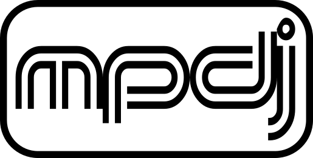
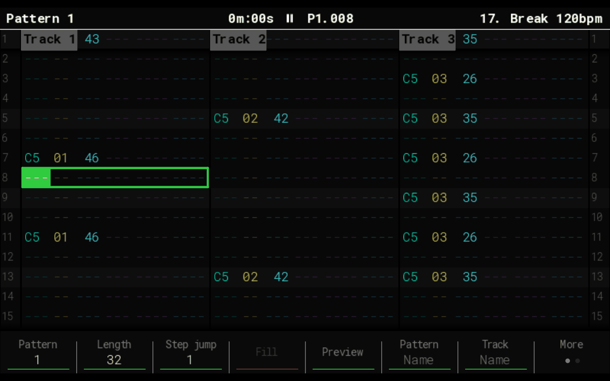
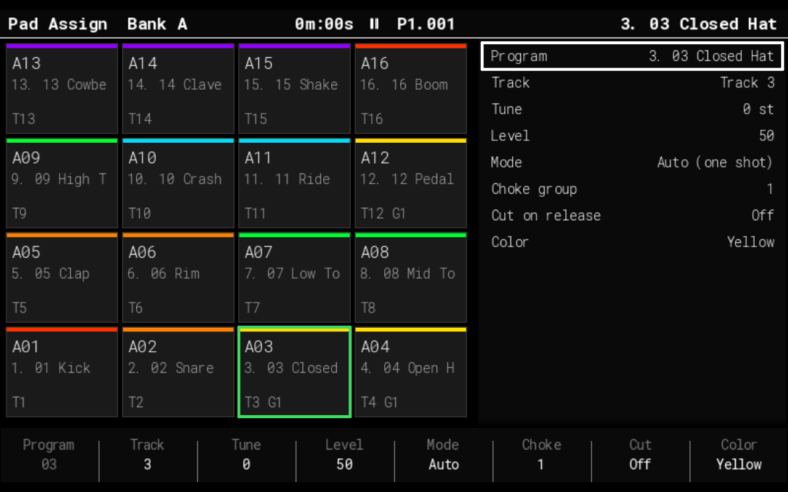
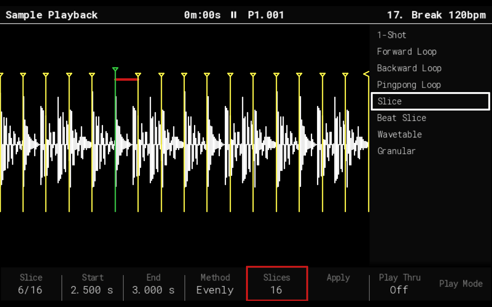
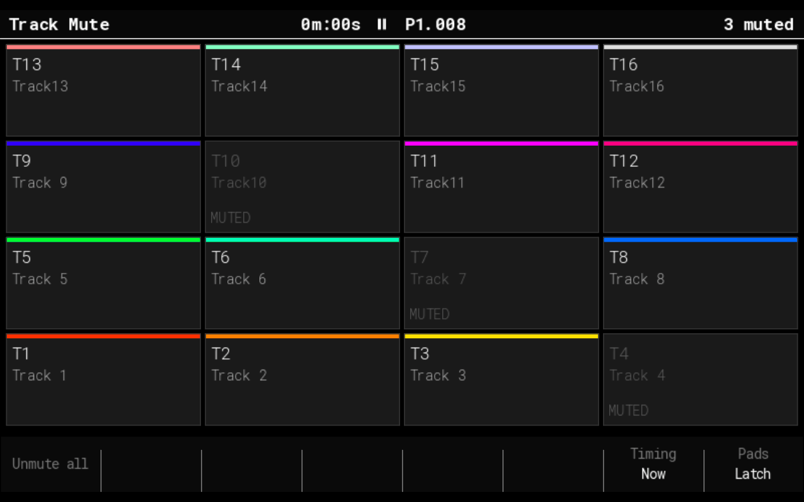

<p align="center"></p>

<p align="center"><b>A tracker that runs natively on the Akai MPC One+</b></p>

<p align="center">
  
  
  
  
</p>

<p align="center">
  <a href="#status">Status</a> ·
  <a href="#requirements">Requirements</a> ·
  <a href="#build">Build</a> ·
  <a href="#install-and-run">Install</a> ·
  <a href="#license">License</a>
</p>

**MPDJ** (MPDJ Tracker) runs a tracker natively on the **Akai MPC One+**, in place of the MPC app. It is a port of [Polyend Tracker Community Edition](https://github.com/polyend/tracker-ce) to the MPC's Linux system: the tracker's sequencer, sample engine and screens, driven by the MPC's pads, Q-Link knobs, buttons, touchscreen and audio interface.

> **Unofficial and free.** MPDJ is a hobby project. It is not made, endorsed or supported by Polyend, Akai Professional or inMusic. "Polyend" and "Polyend Tracker" are Polyend's trademarks; "MPC" and "Akai Professional" belong to inMusic Brands. MPDJ is free and will never be sold (see [License](#license)).

<table>
  <tr>
    <td width="50%"></td>
    <td width="50%"></td>
  </tr>
  <tr>
    <td align="center"><sub>The Pattern screen: note, program, volume, micromove and two effects per track</sub></td>
    <td align="center"><sub>Pad Assign: each pad's program, track, mode, choke group and color</sub></td>
  </tr>
  <tr>
    <td width="50%"></td>
    <td width="50%"></td>
  </tr>
  <tr>
    <td align="center"><sub>MPC-style slicing: a loop cut into 16 slices, played from the pads</sub></td>
    <td align="center"><sub>Track Mute: 16 tracks on the 16 pads</sub></td>
  </tr>
</table>

<sub>Screenshots from MPDJ's own renderer at the MPC's 1280x800 resolution, with the MPDJ Kit and a drum loop made from it.</sub>

## Status

Early and in active development. On an MPC One+ it currently:

- boots the tracker full screen (1280x800, the Tracker's UI scaled up), on the MPC's own sound card at 44.1 kHz with ~7 ms round trip
- plays and edits patterns and songs, loads and plays samples from the SD card (including long streamed ones), takes audio from the MPC's inputs
- has 64 program slots (sample or MIDI) and 16 equal tracks, each with its own sample voice
- plays MPC-style pads: 4 banks of 16 pads, each mapped to a program and a track, velocity-sensitive with pad lights and colors; live and step recording, OVER DUB, ERASE + pad, Note Repeat, 16 Levels, Notes mode, Full Level, timing correct, choke groups, STEP SEQ
- has its own screens for Pad Assign and Track Mute, MPC-style slicing (manual, auto, evenly, by beats) with a slice layer on the pads, Loop Sync, kits (load and save a bank's sounds and pad settings), global swing and a six-column Pattern view
- maps the MPC's controls: transport and mode buttons with LEDs, the four Q-Links (navigation and value modes, per-screen knobs on waveform screens), the main encoder and the touchscreen

Planned: open-source synth engines, insert effects, recording while the pattern plays, external resampling through pedals, USB audio to a computer, starting at power-on, and "sideloads" (separate programs started from MPDJ).

MPDJ saves projects in its own format. Tracker and Tracker+ projects can be opened (a one-way import: samples go to program slots 1-48, MIDI instruments to 49-64), but projects saved by MPDJ don't open on a Tracker.

Polyend's factory synth engines are closed binaries for the Tracker's chip and are not part of MPDJ.

## Requirements

- An Akai MPC One+ on MPC firmware 2.14 with SSH access (a community SSH mod). Other MPC models are untested
- A computer to build on (macOS or Linux) and to copy files over SSH
- An SD card in the MPC for samples and projects

Running MPDJ stops the MPC app while it runs and doesn't change the MPC's system partition; restarting the MPC app (or the MPC) brings everything back. Still, modifying your MPC is at your own risk and may affect its warranty.

What we've learned about the MPC One+'s hardware and system while building MPDJ (audio latency, the controller's MIDI and LED maps, display, USB and more) is written up separately for anyone hacking on MPCs: [MPC Linux notes](https://github.com/longcutter/mpc-linux-notes).

## Build

MPDJ cross-compiles for 32-bit ARM Linux with [zig](https://ziglang.org/) as the C/C++ toolchain:

```
pip3 install ziglang
make -C platforms/mpc -j4 strip
```

The binary is `platforms/mpc/build/tracker-mpc`.

## Install and run

Assuming the MPC answers to `ssh mpc`:

```
ssh mpc 'mkdir -p /media/az01-internal/mpdj "/media/MPC SDC/MPDJ"'
scp platforms/mpc/build/tracker-mpc mpc:/media/az01-internal/mpdj/tracker-mpc
ssh mpc 'chmod +x /media/az01-internal/mpdj/tracker-mpc && systemctl stop inmusic-mpc'
ssh -t mpc 'cd /media/az01-internal/mpdj && ./tracker-mpc'
```

Ctrl+C quits. Start the MPC app again with `ssh mpc 'systemctl start inmusic-mpc'`. MPDJ's files (samples, projects) live in `MPDJ` on the SD card.

## Repository

- `mpc-port` (default branch): MPDJ. The MPC platform layer is in `platforms/mpc/`; changes to the shared tracker code are kept small and marked `MPDJ` or `PLATFORM_MPC`
- `main`: Polyend's Tracker CE as forked; upstream changes are reviewed and merged into `mpc-port` by hand
- Polyend's original README and changelog: [`docs/README-tracker-ce.md`](docs/README-tracker-ce.md), [`docs/CHANGELOG-tracker-ce.md`](docs/CHANGELOG-tracker-ce.md); the Tracker CE developer docs are in `docs/`

## Feedback and contributing

Found a bug? Open an [issue](../../issues/new/choose) with the bug template. Questions, ideas and show-and-tell go to [Discussions](../../discussions). MPDJ is a one-person hobby project, so replies can take a while; see [`CONTRIBUTING.md`](CONTRIBUTING.md) before opening a pull request.

## License

MPDJ is a derivative of Polyend Tracker Community Edition and follows its [`LICENSE`](LICENSE): MIT, with a restriction on selling the complete Tracker application or a port of it. That's why MPDJ is free and will stay free. Making and selling music with it is fine.

- Individual parts (drivers, DSP, the MPC platform layer) can be reused in other projects under the MIT terms, as the license allows
- MPDJ's own additions are released under the MIT License as well
- Third-party components and credits: [`NOTICE.md`](NOTICE.md)
- Separate programs that MPDJ can start ("sideloads") keep their own licenses and are not part of MPDJ's code
